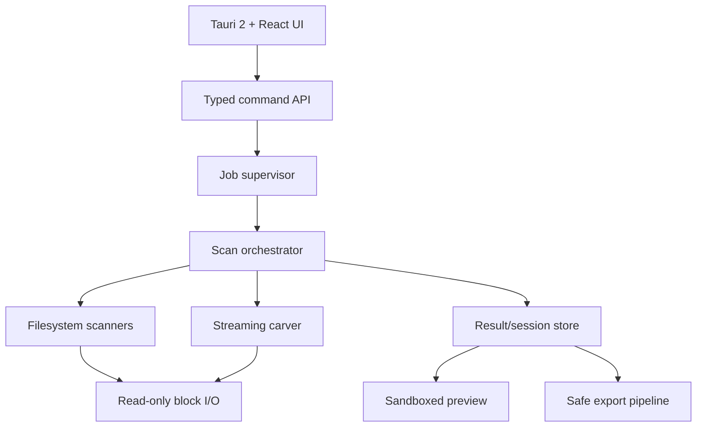

# Original recovery-engine architecture

## Product boundary

The initial Windows release handles local physical disks, attached removable media, and read-only image files. It recovers from NTFS, FAT32, exFAT, and EXT4 volumes, and uses raw carving as a filesystem-independent fallback. The architecture intentionally has no dependency on a reference product.

## Layered design

## Rust workspace proposal

| Crate | Responsibility | Must never do |
| --- | --- | --- |
| `recovery-domain` | Stable value types: ranges, device IDs, findings, confidence, errors. | Call Win32 directly. |
| `recovery-blockio` | Read-only Windows disk/image access, aligned buffering, retries, cancellation, telemetry. | Write to source media. |
| `recovery-partition` | MBR/GPT parsing and protective validation. | Repair or write partition tables. |
| `recovery-fs-*` | Independent parsers/scanners for each filesystem. | Trust unchecked offsets or lengths. |
| `recovery-carve` | Signature compiler, streaming matcher, validators, fragment policy. | Load unbounded files into memory. |
| `recovery-session` | SQLite index and versioned checkpoint encoding. | Bind a resume state to an unverified device. |
| `recovery-preview` | MIME-aware sample/range rendering via constrained adapters. | Parse untrusted bytes in the UI process. |
| `recovery-export` | Destination validation, sparse-aware copy, atomic finalization, hash verification. | Export onto the source device. |
| `recovery-app` | Tauri commands, authorization boundary, UI event translation. | Contain scanning logic. |

## Scan protocol

1. Open a source as a read-only capability with a stable identity: hardware path, geometry, serial when available, and a sampled fingerprint. Refuse read/write access requests.
2. Enumerate partition tables and filesystem candidates. Every numeric conversion and disk range is checked before I/O.
3. Run a metadata pass for the recognized filesystem. Produce a `Finding` for each valid directory entry, inode, or MFT record with source extents and a confidence explanation.
4. Run the deep scan as chunked sequential work. Chunk ownership is explicit; results are de-duplicated by physical extent plus content identity, not filename.
5. Optionally run the raw carver. A candidate must meet signature, length, structural validator, and overlap-policy rules before becoming a finding.
6. Persist a checkpoint only after atomic commit of result-index state. A resumed job must match source fingerprint and scanner/signature versions.
7. Preview using copied ranges or a virtual reader capped by byte/time budgets. Preview failure never changes recovery eligibility.
8. Export to a validated destination on a different physical disk. Write to a temporary file, stream hash if requested, fsync, then atomically rename.

## Finding model

Every result should have: `id`, `source_id`, `method` (metadata/carve), filesystem/type, logical path if known, physical extents, declared size, recoverable byte count, corruption flags, confidence factors, signature version, and preview/validation status. A single opaque “recovery chance” value is insufficient for auditability.

## Raw-carving strategy

Signatures are original versioned data files. A signature can declare headers, optional footers, offset constraints, size bounds, byte order, and a format-specific validator. The engine compiles headers into an Aho–Corasick automaton, scans a bounded buffer with overlap, and dispatches only plausible hits to validators. Fragmented recovery is initially unsupported by default: findings must say so rather than silently emitting corrupt files.

## Safety, performance, and quality gates

- Source read handles are opened with Windows read-only access and explicit sharing policy; the code path has no source-write API.
- Large scans use bounded buffers, backpressure, cooperative cancellation, and adaptive sequential-read windows. No unbounded result or preview queue.
- Parsing uses checked arithmetic, limits nesting/recursion, and converts malformed media into typed errors, never panics.
- The core requires `cargo fmt --check`, `cargo clippy -- -D warnings`, unit/integration/property tests, fuzz targets for every parser, and release-profile benchmarks.
- The UI consumes a rate-limited event stream and virtualized result lists; Canvas is a later visualization layer, not the recovery engine.

## Delivery sequence

1. Image-file read path, GPT/MBR parsing, synthetic fixtures, and safe export.
2. FAT32/exFAT metadata recovery plus generic image preview.
3. NTFS deleted-record path, runlist validation, and sparse/non-resident data export.
4. Declarative raw carving with JPEG, PNG, PDF, ZIP, and MP4 validators.
5. EXT4 metadata recovery and job/session resumption.
6. Physical-disk access, privilege-boundary hardening, Windows installer, MSIX packaging, and signed release pipeline.
