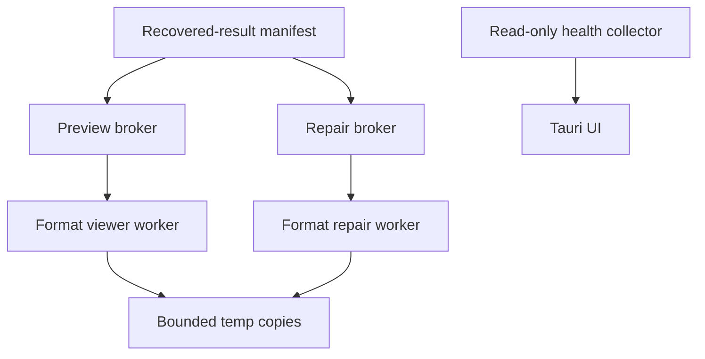

# Utility subsystem study and original expansion plan

## Evidence boundary

This document records static observations from the locally supplied Windows deployment. No utility executable was run, no source was recovered, and no vendor assets, strings, or code are reused.

## Observed utility map

| Area | Observed evidence | Narrow conclusion |
| --- | --- | --- |
| File repair | Separate repair executables cover images, PDF, Office, archives, and Adobe-related image/document content. The repair subtree bundles ImageMagick-family libraries, HEIF support, 7-Zip, OpenSSL, libcurl, and image codecs. | Repair is implemented as a distinct worker/tool family rather than inside the recovery scan engine. |
| Image repair | The image worker references corrupt/truncated image handling, RAW support, thumbnail decoding, and common image/metadata codecs. | An image-repair feature likely parses and rewrites selected formats; exact algorithms are not established. |
| PDF repair | The PDF worker has strings for object, indirect-reference, stream, xref, encryption-dictionary, and sorting/error handling. | It contains a structural PDF parser/repair path, including encrypted-PDF error handling. |
| Archive repair | The archive worker bundles 7-Zip, has ZIP/7z/RAR4/RAR5 class names, header bounds/CRC checks, extraction/error paths, and password-related errors. | It analyses archive structure and can validate/extract supported archives; password protection is recognized, not bypassed. |
| Office repair | Dedicated office repair/viewing binaries exist; the repair worker imports OpenSSL and OLE/COM libraries. | There is a separate Office-oriented repair/viewing path. This does not prove individual format behavior. |
| Disk health | `DiskHealth.exe` is a 32-bit Qt/QML application importing Windows configuration/setup APIs. Its strings show WMI disk enumeration, ATA SMART commands, NVMe and USB bridge paths, vendor-specific SMART decoding, temperature, wear, error, and firmware information. | It is a drive telemetry application that normalizes SMART/NVMe data across transports and vendors. |
| Video viewing/repair | Separate 32-bit viewer/repair binaries bundle FFmpeg 62 libraries. Repair strings name container/frame parsers, quick/advanced flows, reference-sample handling, stream extraction, and remuxing. | It has a file-based media inspection/repair pipeline built around container parsing and FFmpeg-style decode/remux components. |
| Office/PDF viewing | Dedicated 64-bit Office/PDF viewers and a bundled PDF engine are present. | Recovered files can be previewed through dedicated viewer processes rather than UI-only rendering. |

## Important design conclusion

Recovery, repair, and preview must not share a trust boundary. Recovery reads hostile disk data; repair parsers process hostile recovered files; previews process hostile media/documents. The original project will use separate processes or tightly sandboxed workers with bounded input, time, memory, and output paths.

## Original subsystem architecture

### A. Disk health

Implement this early enough to warn users before long scans, but keep it read-only and advisory.

- `health-windows`: enumerate physical disks through documented Windows storage APIs; collect model, serial, firmware, bus type, capacity, and read-only status.
- `health-smart`: issue only documented read-only SMART/NVMe log queries. Preserve raw attribute values, normalized values, thresholds, and source protocol.
- `health-normalize`: vendor mapping is versioned data, not hard-coded UI logic. Unknown attributes display as raw identifiers rather than guessed diagnoses.
- `health-assessment`: report evidence-backed conditions such as reallocated sectors, pending sectors, uncorrectable errors, temperature, percentage-used, media errors, and critical warnings. Never infer imminent failure from one opaque score.
- Safety rule: health collection must not write, enable, disable, reset, or change drive features.

### B. Preview

Preview is a decision aid and must never modify a finding. Build a broker that chooses a worker by verified MIME/container structure, not filename extension. Workers receive a capped temporary copy or range-backed read endpoint and return a thumbnail, normalized metadata, duration/page count, and failure category. Start with images, plain text, PDF, and audio/video metadata; add Office rendering only after sandboxing is proven.

### C. File repair

Repair is an optional, explicit post-recovery operation. It must write a new artifact and immutable repair report; the original recovered output remains untouched.

| Repair family | First original capability | Deferred capability |
| --- | --- | --- |
| Images | Validate container structure; safely rebuild metadata or thumbnails only when an independently specified format permits it. | Proprietary RAW variants and heuristic pixel reconstruction. |
| PDF | Validate objects/xref; produce a repaired copy only for documented, testable structural defects. | Encrypted-document modifications or semantic content reconstruction. |
| ZIP | Validate central directory/local headers; recover intact entries into a new archive/directory. | Encrypted archive handling beyond user-supplied password validation. |
| Office | Validate OOXML ZIP/container parts and surface recoverable components. | Legacy binary Office reconstruction. |
| Video | Inspect container/index; remux readable streams into a new container with provenance. | Codec/frame reconstruction and reference-video heuristics. |

No repair module may evade encryption, DRM, passwords, or access controls. A password can be supplied by the owner only to open a file they are authorized to access; failures remain failures.

### D. Media and document viewing

Use a common `artifact-inspection` contract: an input reference, byte/time/memory limits, zero network access, and structured output. Prefer mature, permissively compatible libraries with maintained Rust bindings or process isolation. For video, use an independently licensed FFmpeg integration only after license review; never bundle a component without satisfying its distribution obligations.

## Test and release requirements

- Every worker gets a malicious-input corpus, timeout, memory cap, and crash-only restart policy.
- Repair is judged against fixture-specific structural and content hashes, never by a generic success string.
- Preview must be disabled safely if a worker fails; a preview crash never affects scanning or export.
- Health readings retain raw evidence and timestamps; the UI explains uncertainty and never gives medical-style certainty about disk failure.
- Third-party dependency licenses, source provenance, SBOM entries, and vulnerability monitoring are mandatory before public release.

## Delivery order

1. Health inventory and read-only SMART/NVMe telemetry.
2. Sandboxed image/text/PDF preview and result-manifest integration.
3. ZIP validation/extraction and basic image container validation.
4. PDF structural validation/repair research with dedicated fixtures.
5. OOXML inspection and media metadata/remuxing in isolated workers.
6. Advanced repair only after format-specific test coverage and licensing review.
